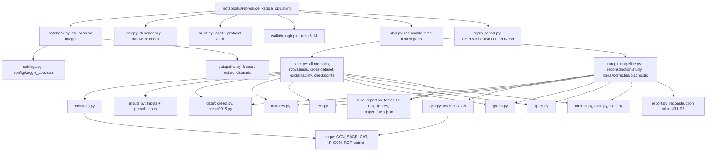

# Architecture

Independent reconstruction, not the original implementation. Two things are implemented:

1. **The reconstructed original framework** (metadata + text + GCN → LightGBM), in the two architecture variants the
   manuscript describes inconsistently, **P1** and **P3**, each with two GCN output taps.
2. **The revised paper's experiment suite**: baselines, modality ablations, the proposed RGF model and its ablations.

## Data flow (reconstructed framework)

```mermaid
flowchart LR
  subgraph Inputs
    P[Profile fields] --> F[Metadata features<br/>4 core: age, follower ratio,<br/>tweet frequency, username entropy]
    T[Bio (variant B) or<br/>20 tweets (variant A)] --> E[Frozen text encoder<br/>B: all-MiniLM-L6-v2, mean, 384-d<br/>A: bert-base-uncased, CLS, 768-d]
    N[Cresci-2015 follower/friend edges] --> GR
  end
  F -->|"m (d_m = 4)"| X["x = [m || t]"]
  E -->|"t (d_t = 384 or 768)"| X
  F -->|Cresci-2017: kNN k=10, cosine| GR[Graph, symmetrised<br/>Â = D^-1/2 (A+I) D^-1/2]
  X --> GCN["GCN(d_m+d_t → 64) → ReLU → Dropout 0.5 → GCN(64 → 2)"]
  GR --> GCN
  GCN -->|"hidden h (64-d)"| TAP{tap}
  GCN -->|"probabilities (2-d)"| TAP
  TAP -->|P3: r only| L[LightGBM<br/>gbdt, 31 leaves, lr 0.05,<br/>≤1000 trees, early stop 50]
  TAP -->|"P1: [m || t || r]"| L
  F -. P1 .-> L
  E -. P1 .-> L
  L --> Y[P(bot)]
```

Training (corrected protocol): the GCN is trained on training half A with validation-loss selection; LightGBM is
trained on GCN outputs for half B and early-stopped on validation (blending, which avoids reusing label-fitted
embeddings of the same accounts). Test labels never enter any fit.

## Dimensions

| Tensor | Shape | Notes |
| --- | --- | --- |
| m | N × 4 | `core4`; `extended6` adds reputation and engagement (not default) |
| t | N × 384 (B) or N × 768 (A) | zero vector for empty text |
| x = [m ‖ t] | N × 388 (B) or N × 772 (A) | GCN node features |
| GCN hidden h | N × 64 | after ReLU, eval mode |
| GCN probabilities | N × 2 | softmax of layer 2 |
| LightGBM input, P3-hidden / P3-prob | N × 64 / N × 2 | |
| LightGBM input, P1-hidden / P1-prob | N × (d_m + d_t + 64) / N × (d_m + d_t + 2) | e.g. 452 / 390 with variant B |

## Architecture variants (never merged)

| Name in results | LightGBM input | Source in the manuscript |
| --- | --- | --- |
| Reconstructed hybrid (P3, hidden) | GCN 64-d embedding | Alg. 1, Sec. 4.2, Fig. 1; co-author recollection |
| Reconstructed hybrid (P3, prob) | GCN 2-d probabilities | Same; the tap is unstated |
| Reconstructed hybrid (P1, hidden) | metadata + text + GCN 64-d | Sec. 3.1 |
| Reconstructed hybrid (P1, prob) | metadata + text + GCN 2-d | Sec. 3.1; the tap is unstated |

The best of the four is chosen per dataset by **validation** F1 for the main table; all four appear in table T3b.

## Proposed model: RGF (Reliability-Gated Fusion)

```mermaid
flowchart LR
  m[m] --> Em[metadata expert<br/>MLP → 64] --> Zm[logits z_m]
  t[t] --> Et[text expert<br/>MLP → 64, × text available] --> Zt[logits z_t]
  Em --> S["[h_m || h_t]"]
  Et --> S
  S --> Eg[graph expert<br/>2 × neighbour mean → 64,<br/>× degree > 0] --> Zg[logits z_g]
  R[reliability signals:<br/>text available, graph available,<br/>log degree, expert entropies] --> Gt[gate MLP 6 → 32 → 3<br/>masked softmax over available experts]
  Zm --> Mix["Σ w_k z_k / T"]
  Zt --> Mix
  Zg --> Mix
  Gt --> Mix
  Mix --> Yr[P(bot)]
```

Training: cross-entropy on the fused logits + 0.5 × per-expert losses; random modality dropout (p = 0.3) for text and
graph; AdamW lr 0.005, ≤ 300 epochs, early stopping on validation loss (patience 40); temperature T fitted on
validation NLL. Ablations: no gate (mean of available experts), no modality dropout, no auxiliary losses, concat
fusion, and each expert removed.

## Modules


